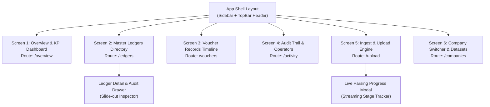

# Frontend Sitemap & Stitch UI Architecture Specification
### Application: Tally Prime EditLog Extractor & Intelligence Dashboard

This document provides a comprehensive frontend sitemap, component breakdown, information architecture, and prompt-ready specifications tailored for **Stitch** to generate and maintain screens.

---

## 1. Visual Sitemap & Navigation Hierarchy



---

## 2. Design System Tokens (Stitch Standard)

```yaml
---
name: Tally Intelligence Dark
theme: DARK
colors:
  background: "#060911"
  surface: "#0a0f1d"
  surface-card: "rgba(17, 24, 39, 0.75)"
  surface-card-solid: "#111827"
  surface-elevated: "#1e293b"
  border-subtle: "rgba(255, 255, 255, 0.08)"
  border-focus: "rgba(99, 102, 241, 0.4)"
  primary: "#6366f1"
  primary-gradient: "linear-gradient(135deg, #6366f1 0%, #9333ea 100%)"
  accent-cyan: "#06b6d4"
  accent-emerald: "#10b981"
  accent-amber: "#f59e0b"
  accent-rose: "#f43f5e"
  text-primary: "#f8fafc"
  text-secondary: "#94a3b8"
  text-muted: "#64748b"
typography:
  display: "Outfit, sans-serif"
  body: "Inter, sans-serif"
  code: "JetBrains Mono, monospace"
rounded:
  sm: "6px"
  md: "10px"
  lg: "16px"
  full: "9999px"
---
```

---

## 3. Global Shell Components

### A. Persistent Navigation Sidebar
- **Brand Logo:** Indigo glowing database icon + "TallyLog Extractor" logo mark + "EditLog 2.1 Engine" sublabel.
- **Active Dataset Card:** Selected Company selector dropdown, data cutoff date badge, and `ready` status pill.
- **Navigation Menu Items:**
  1. Overview & KPIs (`LayoutDashboard`)
  2. Ledgers Directory (`BookOpen`)
  3. Voucher Records (`Receipt`)
  4. Audit & Operators (`Users`)
  5. Ingest & Upload (`UploadCloud`)
- **System Footer:** SQLite local database live connection pulse indicator + parser version badge.

### B. Sticky Context TopBar
- **Left Context:** Active page H1 title, descriptive subtitle, and company badge.
- **Right Action Bar:**
  - `Refresh Data` button (re-polls SQLite stats).
  - `Export CSV` button (instant download of active ledgers).
  - `Ingest Data` primary gradient CTA button.

---

## 4. Screen-by-Screen Breakdown & Stitch Generation Prompts

### Screen 1: Executive Overview & KPI Dashboard
- **Route:** `/` or `/overview`
- **Purpose:** High-level executive accounting metrics, ledger group breakdown, and tax compliance summary.
- **Key Visual Sections:**
  1. **Hero KPI Row (5 Glassmorphism Cards):**
     - *Total Ledgers:* Count (e.g. 4,707), account groups subtext. Indigo gradient icon.
     - *Voucher Records:* Count (e.g. 76,652), fiscal years captured. Cyan gradient icon.
     - *PAN Identified:* Count (e.g. 3,476), coverage percentage (74%). Emerald gradient icon.
     - *GST Registrations:* Count (e.g. 607), verified entities percentage. Amber gradient icon.
     - *Audit Operators:* Count (e.g. 5), tracked active sessions. Rose gradient icon.
  2. **Split Analytics Row (2 Columns):**
     - *Left Column - Account Groups Breakdown:* Top groups (Sundry Debtors, Creditors, Service Groups, Capital Accounts) with proportional gradient progress bars and entity counts.
     - *Right Column - Statutory Compliance & Operator Sessions:*
       - PAN and GSTIN verification KPI cards.
       - Operator session badge chips (`MANISH`, `HASNAIN`, `pareek`, `bmw`, `ankit`).
  3. **File Source Status Row:** 4 grid cards detailing the parsed `.900` binary files (`Manager.900`, `LinkMgr.900`, `SumTran.900`, `AddlCmp.900`) and extracted record counts.

> **Stitch Prompt for Screen 1:**
> ```text
> Desktop dark mode executive analytics dashboard for Tally Prime accounting data. Deep navy-black background (#060911) with glassmorphism cards and subtle indigo glows. Top bar contains page title 'Company Analytics & KPIs' and company pill 'BMW Ventures Limited' with Refresh, Export CSV, and Ingest Data buttons. Left sidebar contains logo, company dropdown, and 5 navigation tabs. Main content has a top row of 5 KPI cards: Total Ledgers (4,707 with indigo icon), Voucher Records (76,652 with cyan icon), PAN Identified (3,476, 74% coverage with emerald icon), GST Registrations (607 with amber icon), and Audit Operators (5 with rose icon). Below is a two-column layout: left column shows 'Account Groups Breakdown' with gradient horizontal progress bars for Sundry Debtors, Sundry Creditors, etc. Right column shows 'Statutory & Tax Compliance' cards and top operator chips. Bottom row shows 4 status cards for Manager.900, LinkMgr.900, SumTran.900, and AddlCmp.900 binary source files.
> ```

---

### Screen 2: Master Ledgers Directory & Audit Inspector
- **Route:** `/ledgers`
- **Purpose:** Full searchable accounting master directory with inline tax data and expandable EditLog change tracking.
- **Key Visual Sections:**
  1. **Filter & Action Toolbar:**
     - Search input field (searching by Name, Contact, PAN, GSTIN, Phone, Address).
     - Account Group filter dropdown (e.g. "Sundry Debtors (2,845)", "Sundry Creditors (1,120)").
     - Export Filtered CSV button.
     - Pagination & page size control (25, 50, 100 rows).
  2. **Master Ledgers Data Grid:**
     - Columns: `Expand/Collapse Icon`, `Ledger / Entity Name`, `Account Group`, `PAN`, `GSTIN`, `Phone`, `PIN / City`, `Audit Summary`.
     - Monospaced badges for PAN (emerald) and GSTIN (amber) with click-to-copy icons.
     - Group pill tags.
  3. **Expandable Row Detail Drawer (Open State):**
     - *Card 1 (Location):* Street address, locality/city, postal PIN, state, and country.
     - *Card 2 (Contact & Tax Identity):* Contact person, primary telephone, alternate telephone, full PAN, full GSTIN.
     - *Card 3 (EditLog 2.1 Audit Trail):* Created By user, creation time (`17:35:11`), Altered By user, alteration time, and audit action badge (`Alteration`, `Creation`).
     - *Card 4 (Raw Chunk Segment):* Monospace snippet of the parsed raw tilde-delimited binary string.

> **Stitch Prompt for Screen 2:**
> ```text
> Dark themed data table page for accounting master ledgers. Top toolbar has an expanded search bar with placeholder 'Search ledger, PAN, GSTIN, phone, address...', a group dropdown filter, page size selector, and 'Export CSV' button. The table has dark glassmorphism styling with headers: Ledger Name, Account Group, PAN, GSTIN, Phone, PIN/City, and Audit Trail. Rows show company names in bold white, groups in subtle muted pills, PAN numbers in glowing emerald monospace badges with copy icon, and GSTIN in amber monospace badges. One row is expanded showing a slide-down card with 3 grid columns: 'Address & Location' with street and city info, 'Identity & Contact' with contact person and phone numbers, and 'EditLog 2.1 Audit Trail' showing Created By, Created At, Altered By, and Action Type badges. Below is pagination with Prev/Next buttons.
> ```

---

### Screen 3: Transaction Vouchers & Sequence Ledger
- **Route:** `/vouchers`
- **Purpose:** Explorer for chronological transaction voucher sequences extracted from `LinkMgr.900`.
- **Key Visual Sections:**
  1. **Fiscal Year Badge Bar:** Horizontal pill filter displaying captured financial years (`FY 2017-18`, `FY 2018-19`, etc.) with voucher counts.
  2. **Search Bar:** Search by exact voucher pattern (e.g. `BMW/003461`).
  3. **Vouchers Data Table:**
     - Columns: `Sequence Index`, `Voucher Reference Number` (Indigo monospace with copy button), `Date Marker` (e.g. `28-Aug-17`), `Standardized Date` (e.g. `2017-08-28`), `Financial Year` (Cyan pill).
  4. **Pagination Bar:** Previous / Next and page count indicator.

> **Stitch Prompt for Screen 3:**
> ```text
> Dark mode transaction voucher ledger explorer. Top section features a row of horizontal financial year pill buttons: 'FY 2017-18 (12,450)', 'FY 2018-19 (18,200)', etc. with calendar icons. Below is a search bar filtering voucher numbers. The main table displays voucher records with columns: Index (#1), Voucher Reference Number (e.g. 'BMW/003461/17-18' in glowing purple monospace font with copy button), Date Marker ('28-Aug-17'), Standardized Date ('2017-08-28'), and Financial Year tag ('2017-18' cyan badge). Glassmorphism borders and pagination at bottom.
> ```

---

### Screen 4: EditLog Operators & User Activity Audit
- **Route:** `/activity`
- **Purpose:** Audit tracking for operator accounts, active user sessions, and EditLog transactions from `SumTran.900`.
- **Key Visual Sections:**
  1. **Operator Cards Grid:** Grid cards for top users (`MANISH`, `HASNAIN`, `pareek`, `bmw`, `ankit`) displaying operator avatar/icon, username, and total session count badge.
  2. **Session Transaction Log Table:**
     - Columns: `Entry #`, `Operator Username`, `Activity Type` (`Session`), `Session UUID` (Monospace string with copy icon).

> **Stitch Prompt for Screen 4:**
> ```text
> Dark mode user audit log and operator activity dashboard for Tally EditLog. Top section shows a grid of operator profile cards for 'HASNAIN', 'MANISH', 'pareek', 'bmw' with operator icons, usernames, and session count badges (e.g. '42 Sessions'). Below is a comprehensive session log table with columns: Entry #, Operator Username, Activity Type (green 'Session' badge), and Session UUID (full 36-character UUID string in monospace font with click-to-copy button). Pagination at bottom.
> ```

---

### Screen 5: Ingestion Engine & Upload Zone
- **Route:** `/upload`
- **Purpose:** Central ingestion interface for loading new Tally data via local folder scan or ZIP archive upload.
- **Key Visual Sections:**
  1. **Card 1: Direct Local Directory Ingestion (Instant Scan):**
     - Heading: "Direct Local Directory Ingest (Instant)".
     - Subtitle explaining that multi-gigabyte folders can be ingested directly without compressing.
     - Input 1: `Local Folder Path` (e.g. `D:\tally extractor\Tally Prime EditLog 2.1 Data...`).
     - Input 2: `Company Name Override` (optional).
     - CTA Button: `Scan & Ingest Local Folder` (Emerald button with arrow icon).
  2. **Card 2: Drag-and-Drop ZIP Dropzone:**
     - Large dashed drop area with upload cloud icon.
     - Text: "Click to select or drop ZIP file here".
     - Subtext: "Supports standard zip archives up to 10GB".
     - CTA Button: `Upload & Parse Archive` (Indigo gradient button).
  3. **Live Parsing Progress Tracker (Active State):**
     - Glass card with glowing indigo border.
     - Stage indicator: `Stage: LEDGERS` / `VOUCHERS` / `ACTIVITY` / `COMPLETE`.
     - Percentage counter and smooth gradient progress bar.
     - Real-time detail message (e.g. "Parsed 3,450 ledgers...").

> **Stitch Prompt for Screen 5:**
> ```text
> Dark theme data upload and ingestion interface. Center-aligned title 'Tally Data Ingestion Engine'. Two stacked glassmorphism cards: Card 1 is 'Direct Local Directory Ingest' with hard drive icon, a text input for local folder path, company name override input, and an emerald green button 'Scan & Ingest Local Folder'. Card 2 is 'Upload ZIP Archive' with a large dashed drag-and-drop zone featuring a cloud upload icon, 'Click to select or drop ZIP file here' text, and a primary indigo upload button. Between the cards is an animated progress bar showing 'Stage: LEDGERS - 65%' with a vibrant purple-blue progress track and detail text 'Parsed 3,200 ledgers...'.
> ```

---

### Screen 6: Multi-Company Management & Datasets
- **Route:** `/companies`
- **Purpose:** Management view for switching between multiple ingested Tally company databases or purging old extracts.
- **Key Visual Sections:**
  1. **Company Cards Grid:**
     - Company Name (`BMW Ventures Limited`), Folder Source Name, Ingestion Date & Time.
     - Quick Stats Pills: Ledgers count, Vouchers count, Operators count.
     - Actions: `Open Dashboard` primary button, `Delete Dataset` danger button.
  2. **"Add New Company" Empty/Action Card:** Dashed card with plus icon navigating to `/upload`.

> **Stitch Prompt for Screen 6:**
> ```text
> Dark mode company management screen displaying a grid of dataset cards. Each card has a company building icon, company title 'BMW Ventures Limited', folder name, ingestion timestamp, and 3 metric badges (4,707 Ledgers, 76,652 Vouchers, 5 Operators). Cards include an 'Open Dashboard' button and a trash can delete icon. An extra dashed card with a plus icon reads 'Ingest New Company Dataset'.
> ```

---

## 5. Summary Matrix for Stitch

| Screen # | Screen Title | Primary Route | Key Stitch Element |
|---|---|---|---|
| **1** | Executive Overview & KPIs | `/overview` | 5 Metric Cards + Progress Bar Breakdown + File Status Grid |
| **2** | Master Ledgers Directory | `/ledgers` | Searchable Data Grid + Monospace Badges + Expandable Drawer |
| **3** | Transaction Vouchers | `/vouchers` | Fiscal Year Pill Filters + Monospace Sequence Table |
| **4** | Audit & User Activity | `/activity` | Operator Profile Cards + Session UUID Inspector |
| **5** | Ingestion & Upload Engine | `/upload` | Local Path Ingest Form + Drag-and-Drop Zone + Progress Bar |
| **6** | Company Datasets | `/companies` | Dataset Cards Grid + Metric Badges + Delete / Switch Actions |
